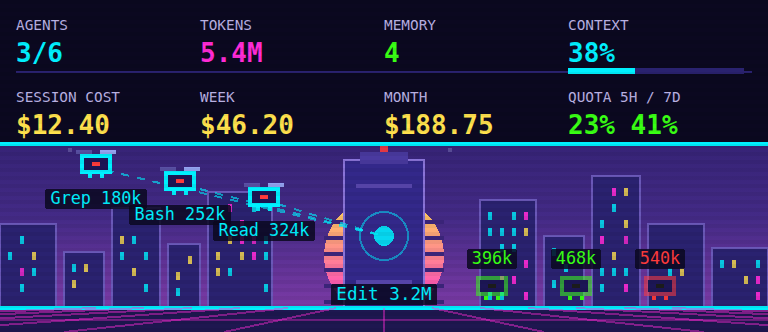
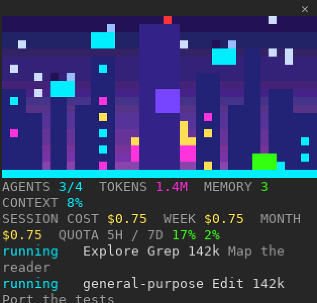
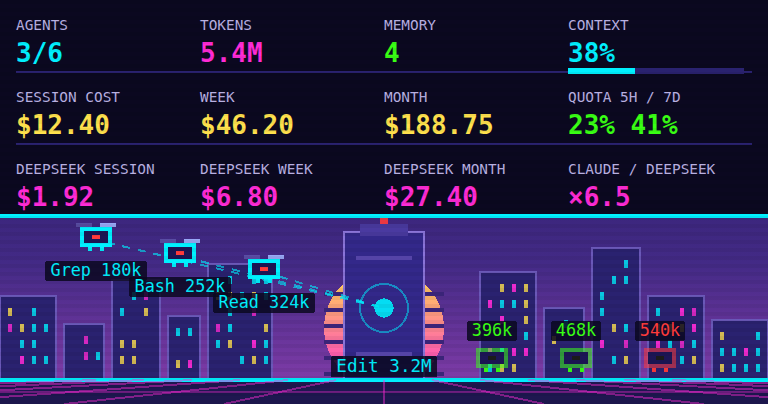

# Consumption HUD

Consumption HUD is a Claude Code plugin that shows what your sessions consume in an animated cyberpunk pane: a neon city where every sub-agent is a drone, the main conversation is a tower with a beating heart, and a HUD gives tokens, context, costs, quota and memory.

It is the plugin edition of the [Claude Consumption extension for VS Code](https://github.com/aelmizeb/claude-consumption-vscode), and it works in the terminal as well as in the editor. It is an independent project, not made or endorsed by Anthropic.



In the terminal the same city is drawn in half-block characters, docked beside the transcript:



## What it shows

- **Agents**: one drone per sub-agent. It flies while the agent works, lands in green once done, in red if it was stopped. The list below the city gives each one's status, type, current tool, tokens and task.
- **Tasks**: the tool each loop is running right now (Bash, Grep, Edit…).
- **Tokens**: the session's total, across the main loop and every sub-agent.
- **Context**: how full the context window is, in red above 80 %.
- **Costs**: the current session, then the current week and month across all your sessions. Session figures come from Claude Code; a past session counts for the `cost-state` lines of its transcript, and whatever those do not cover is estimated at public API prices (a `≈` sign marks it). A session whose model has no known price counts as unpriced (`+n?` next to the month).
- **5h / 7d quota**: the used share of your subscription windows, as Claude Code reports them. `--` when you are not on a subscription, or before the first response.
- **Memory**: the number of entries in the project's `MEMORY.md` index.

## Install

Inside a terminal session of Claude Code:

```
/plugin install consumption-hud --marketplace aelmizeb/claude-consumption-plugin
```

Answer `y` to add the marketplace, then pick a scope. From a shell:

```
claude plugin install consumption-hud --marketplace aelmizeb/claude-consumption-plugin
```

The pane needs Claude Code 2.1.287 or later in the terminal and 2.1.299 or later in the VS Code extension, and the shell command above 2.1.292 or later. It has been tested on 2.1.314.

## Use

The pane opens by itself when a session starts, wherever the window is wide enough to dock it (from 144 columns in a terminal). Otherwise, and whenever you closed it:

| Command | What it does |
| --- | --- |
| `/consumption` | Opens the pane and re-reads everything |
| `/consumption refresh` | The same |
| `/consumption rescan` | Opens the pane and recomputes the week and month costs now |

Each command also prints a one-line summary. Like the output of any command, that line becomes part of the conversation.

## Options

Set them in `/config`.

| Option | Default | What it does |
| --- | --- | --- |
| Open the pane at startup | on | Opens the pane when a session starts, where it can be docked |
| Show the status line | off | Pins a line under the prompt with context, session cost and quota. Claude Code draws it as a notice, with a warning sign |
| Refresh interval (seconds) | 2 | How often the transcripts are re-read |
| Idle after (seconds) | 600 | Without transcript activity for longer than this, the session counts as idle |
| Compare with DeepSeek | off | Adds a row with what the same tokens would have cost on DeepSeek, see below |

## What it reads, runs and stores

The plugin only observes. It makes no network request, calls no model, reads no environment variable, does not change your settings, and does not touch your prompts or tool calls. Nothing it reads leaves your computer.

- **It reads your Claude Code data**, in the folder that holds this session's transcript (`~/.claude` unless you moved it):
  - this session's transcript and those of its sub-agents, for the agents, tools and tokens;
  - every transcript of every project changed since the start of the week or month, for the week and month costs. It keeps only their token counts and cost, never their content;
  - the project's `MEMORY.md` index, for the entry count.
- **It runs one program, `tail`**, as `tail -c +<offset> <transcript>`, on a transcript over 4 MB, because Claude Code's own file API refuses larger files. `tail` only hands the end of that file back to the plugin, which reads it like any other transcript: it sends nothing anywhere, and the plugin starts no other program.
- **It stores one thing**: a cache in the plugin's own store, in your Claude Code data, so unchanged transcripts are not read again. For each transcript it holds the path, size, date, cost and token counts.
- **It hooks these events**, and passes each one on unchanged:
  - `classic.SessionStart` and `classic.UserPromptSubmit`, only to learn where this session's transcript is;
  - `session.start` and `session.attach`, to start when a surface can show the pane;
  - `session.measure`, for the optional status line;
  - `command.run`, only for its own `/consumption` command;
  - `ui.render`, only to draw its own pane.

To check this yourself, `claude plugin validate` lists every event the plugin hooks and every call it makes.

## How the figures are computed

- Context, session cost and quota come straight from Claude Code, as its status line has them.
- Tokens, agents and tools come from the transcript, `<config>/projects/<project>/<session>.jsonl`, and from `<project>/<session>/subagents/agent-<id>.jsonl`, re-read incrementally at every refresh.
- A loop is "running" after a user message or a tool call, "idle" after a final answer or without activity for the idle delay.
- Week and month are scanned at startup, every five minutes and with `/consumption rescan`. A session counts in the period of its last activity, and unchanged transcripts are not read again.

## Comparing with DeepSeek

Turn on **Compare with DeepSeek** to add a HUD row: what the same tokens would have cost on DeepSeek's most expensive offer, `deepseek-v4-pro` at peak rates ($1.32 per million input tokens on a cache miss, $0.044 on a cache hit, $3.96 per million output tokens, from [DeepSeek's price list](https://api-docs.deepseek.com/quick_start/pricing/), read on 2026-10-29), for the session, the week and the month, plus the Claude / DeepSeek ratio of the session. Tokens Claude read from its cache count as cache hits, tokens it wrote to its cache as misses. Sub-agents are included. No request is sent to DeepSeek: the prices are written in the plugin.



## Limits

- Nothing is drawn in `claude -p`, the Agent SDK or cloud sessions. `/consumption` still prints its summary there.
- The editor draws the scene as an image: it animates, but hovering a drone shows nothing, so the agents are listed below the city.
- On Windows, which has no `tail`, a transcript over 4 MB counts as unpriced and, for the current session, its tokens stop updating. Context, session cost and quota are unaffected. Windows has not been tested.
- Prices are written in the plugin, so a new model counts as unpriced until the plugin is updated.

## Development

The plugin has no dependencies and no build: Claude Code loads the TypeScript in `hooks/` and `src/` as it is.

```
claude --plugin-dir .                                # a session with the plugin loaded from this folder
claude plugin test .                                 # the tests
claude plugin validate --strict --profile directory .
```

## License

MIT.
